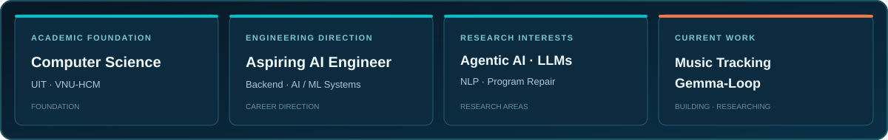
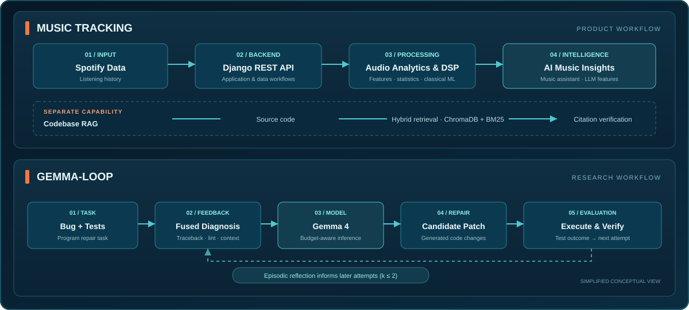

  

  

## About

I'm a **Computer Science student at the University of Information Technology (UIT), VNU-HCM**, interested in building dependable backend systems and applying machine learning to practical problems. My current direction is **AI Engineering**, with a growing focus on LLM-powered and agentic systems.

  

## Technical Focus

<table>
  <tr>
    <td width="50%" valign="top">
      <h3>Backend Engineering</h3>
      Building the application layer that makes AI features usable and dependable.
      <ul>
        <li>REST API design and integration</li>
        <li>Authentication and data workflows</li>
        <li>Background processing and task orchestration</li>
      </ul>
    </td>
    <td width="50%" valign="top">
      <h3>AI / ML Engineering</h3>
      Working with models, inference pipelines, and practical ML applications.
      <ul>
        <li>Model inference and experimentation</li>
        <li>Quantization and inference efficiency</li>
        <li>Audio feature extraction and classical ML</li>
      </ul>
    </td>
  </tr>
  <tr>
    <td width="50%" valign="top">
      <h3>Agentic AI Systems</h3>
      Exploring how language models interact with tools and external environments.
      <ul>
        <li>LLM API integration</li>
        <li>Function / tool calling and ReAct workflows</li>
        <li>Agent harnesses, feedback loops, and evaluation</li>
      </ul>
    </td>
    <td width="50%" valign="top">
      <h3>RAG &amp; Knowledge Grounding</h3>
      Building retrieval pipelines that make generated answers more evidence-based.
      <ul>
        <li>Dense and sparse retrieval</li>
        <li>Hybrid search and rank fusion</li>
        <li>Codebase RAG and citation verification</li>
      </ul>
    </td>
  </tr>
</table>

## Featured Work

<table>
  <tr>
    <td width="50%" valign="top">
      <h3><a href="https://github.com/TranManhHung206/music_tracking">Music Analytics Dashboard</a></h3>
      A Spotify listening-history platform combining analytics, audio signal processing, AI-powered music insights, and a codebase RAG assistant.
      
<strong>My focus</strong>

      <ul>
        <li>Django backend and API integration</li>
        <li>Audio analysis and tool-using assistant</li>
        <li>Hybrid retrieval for codebase Q&amp;A</li>
      </ul>
    </td>
    <td width="50%" valign="top">
      <h3>Gemma-Loop — Budget-Aware Agentic Program Repair</h3>
      A research project studying feedback, fused diagnosis, and episodic reflection for automated program repair under constrained inference budgets.
      
<strong>Research focus</strong>

      <ul>
        <li>LLM-based automated program repair</li>
        <li>Execution feedback and agent workflows</li>
        <li>Inference-budget-aware evaluation</li>
      </ul>
    </td>
  </tr>
</table>

## Project Architecture

  

## Tech Stack

- **Languages:** Python
- **Backend:** Django, Django REST Framework, Celery
- **AI / ML:** PyTorch, Hugging Face Transformers, bitsandbytes, scikit-learn, librosa
- **Retrieval:** ChromaDB
- **Data:** NumPy, Pandas

## The Lost Lobster

  

<em>Still wandering. Still listening.</em>

