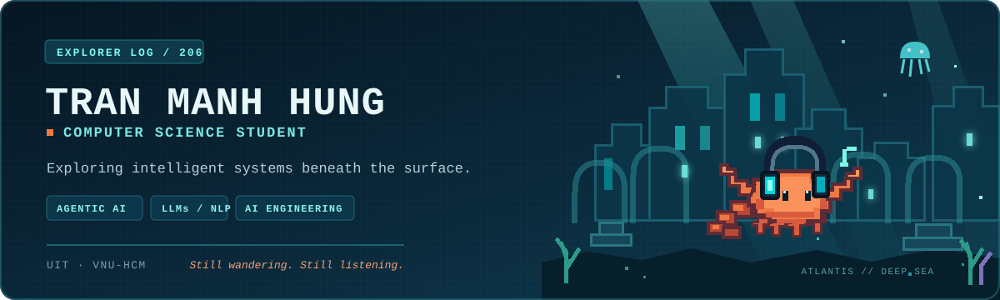
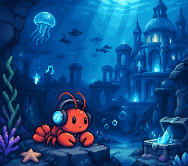

<!--
  Profile README for github.com/TranManhHung206
  Create a public repository named exactly: TranManhHung206
  Keep the assets/ directory beside this README.md.
-->

  

  <strong>Computer Science student · UIT, VNU-HCM</strong> 
  Interested in building intelligent systems and understanding how they work.

  <a href="https://github.com/TranManhHung206">GitHub Profile</a>
  &nbsp;·&nbsp;
  <a href="https://github.com/TranManhHung206?tab=repositories">Repositories</a>

---

## About me

Hi, I'm **Hung** — a Computer Science student at the **University of Information Technology, VNU-HCM**.

I enjoy building software end to end, experimenting with AI systems, and turning research ideas into working prototypes. My current research interests focus on **Agentic AI, Large Language Models, and NLP**. I am exploring these areas as I work toward my long-term goal of becoming an **AI Engineer**.

- **Academic background:** Computer Science.
- **Research interests:** Agentic AI, LLMs, NLP, and Automated Program Repair.
- **Career direction:** AI Engineering — building practical, reliable AI-powered systems.
- **What I build:** full-stack applications, AI-assisted tools, and algorithmic experiments.
- **Outside the terminal:** music, games, and occasionally getting lost in a good idea.

## Research focus

### Gemma-Loop — Budget-Aware Agentic Program Repair

A research project exploring how **feedback, fused diagnosis, and episodic reflection** affect automated program repair under constrained inference budgets. The study uses Gemma 4 and focuses on practical agent design choices: how to diagnose failures, use execution feedback, and manage limited context and token budgets.

Research areas: LLM-based program repair · Agentic workflows · Feedback-driven debugging · Inference efficiency

## Selected projects

<table>
  <tr>
    <td width="50%" valign="top">
      <h3><a href="https://github.com/TranManhHung206/music_tracking">♫ Music Analytics Dashboard</a></h3>
      
A Spotify listening-history tracker with analytics, audio-feature extraction, AI music insights, and a codebase RAG assistant.

      <strong>Stack</strong> React · TypeScript · Django · PostgreSQL · Redis · librosa · scikit-learn · ChromaDB
    </td>
    <td width="50%" valign="top">
      <h3><a href="https://github.com/TranManhHung206/llm_gameof24">◇ LLM Game of 24</a></h3>
      
An exploration of classical search and LLM-guided reasoning for the Game of 24, including DFS, BFS, and a Tree of Thoughts approach.

      <strong>Stack</strong> Python · DFS / BFS · Tree of Thoughts · Llama · Groq API
    </td>
  </tr>
  <tr>
    <td width="50%" valign="top">
      <h3><a href="https://github.com/TranManhHung206/knapsack_solver">▣ Knapsack Solver</a></h3>
      
A test-driven knapsack optimization project using OR-Tools branch-and-bound, with time limits and per-testcase result reporting.

      <strong>Stack</strong> Python · Google OR-Tools · CSV · Optimization
    </td>
    <td width="50%" valign="top">
      <h3>⌁ Current direction</h3>
      
Exploring reliable AI agents: combining language-model reasoning with tools, execution feedback, retrieval, and measurable evaluation.

      <strong>Topics</strong> Agent Harnesses · Tool Use · RAG · Evaluation · Program Repair
    </td>
  </tr>
</table>

## Tech I work with

  <strong>Languages</strong> 
  
  
  

  <strong>Web & backend</strong> 
  
  
  
  
  
  

  <strong>AI, data & retrieval</strong> 
  
  
  
  
  
  

---

## After hours — The Lost Lobster

<table>
  <tr>
    <td width="36%" align="center" valign="middle">
      
    </td>
    <td width="64%" valign="middle">
      <h3>Still wandering. Still listening.</h3>
      
A little lobster with a pair of headphones, wandering through the quiet ruins of a sunken city. A personal nod to my nickname, my love of music, and the peaceful, mysterious worlds I like to get lost in.

      <code>LOCATION: ATLANTIS</code> &nbsp; <code>STATUS: EXPLORING</code>
    </td>
  </tr>
</table>

  Built with curiosity · tuned to the deep sea

